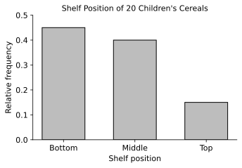
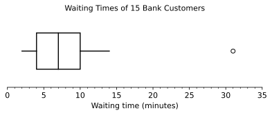

# AP Statistics — Midterm 1 Practice Exam: Answer Key and Scoring Guide

**Teacher's copy.** This goes with [Midterm-1-Practice-Exam.md](Midterm-1-Practice-Exam.md). Every question is referenced to the learning objective (LO), essential knowledge (EK) and skill it assesses in the *AP Statistics Course and Exam Description* (CED, effective Fall 2026). The references are given here rather than on the student paper because an EK statement often *is* the answer: EK 1.11.A.5, for example, is the definition of a cluster random sample.

**Conventions used throughout**

- **Quartiles:** Q1 and Q3 are the medians of the lower and upper halves of the ordered data. When *n* is odd, the median itself is left out of both halves. This is what the TI-84's 1-Var Stats does. A response that uses another recognised method consistently gets full credit.
- **Outliers:** the 1.5 × IQR rule (EK 1.7.D.1.i).
- **Scoring:** each multiple-choice question is worth 3 points. Free-response points are awarded by component, as set out in each rubric.

---

## Answers at a glance

| Q | 1 | 2 | 3 | 4 | 5 | 6 | 7 | 8 | 9 | 10 | 11 | 12 | 13 |
|---|---|---|---|---|---|---|---|---|---|---|---|---|---|
| **Answer** | C | B | D | A | C | D | A | C | B | D | B | C | A |

The key uses A three times, B three times, C four times and D three times.

---

## Exam blueprint

| Item | Syllabus topic | CED learning objective(s) | CED essential knowledge | Skill | Points |
|---|---|---|---|---|---|
| MC 1 | 1.1–1.2 Variables | 1.2.B Identify types of variables | 1.2.B.1, 1.2.B.2 | 2.A | 3 |
| MC 2 | 1.3–1.4 One categorical variable | 1.3.A; 1.4.A Construct categorical graphical representations | 1.3.A.2, 1.3.B.1, 1.4.A.1, 1.4.A.2 | 3.A | 3 |
| MC 3 | 1.5–1.6 Stemplot; describing | 1.5.A; 1.6.A Describe distributions; 1.7.A | 1.5.A.3, 1.6.A.1, 1.6.A.2, 1.7.A.3 | 4.A | 3 |
| MC 4 | 1.5–1.8 Histogram; mean vs median | 1.8.B Describe … based on the relationship of mean and median; 1.7.A | 1.5.A.2, 1.6.A.2, 1.7.A.3, 1.8.B.1 | 4.A | 3 |
| MC 5 | 1.7 Summary statistics | 1.7.C Calculate different units of measurement for summary statistics | 1.7.C.1, 1.7.A.2, 1.7.B.3, 1.7.B.4 | 3.B | 3 |
| MC 6 | 1.8 Boxplots | 1.9.B Compare graphical representations of summary statistics; 1.8.A | 1.8.A.1, 1.8.A.2, 1.7.B.2, 1.7.B.3, 1.9.B.1 | 4.A | 3 |
| MC 7 | 1.9 z-scores | 1.9.D Calculate z-scores; 1.9.E Compare z-scores | 1.9.D.1, 1.9.D.2, 1.9.E.1 | 4.C | 3 |
| MC 8 | 1.9 Percentiles, cumulative relative frequency | 1.7.A Measures of position; 1.7.B Measures of variability | 1.7.A.5, 1.7.A.6, 1.7.B.3 | 3.B | 3 |
| MC 9 | 1.10–1.11 Random sampling | 1.11.A Identify a sampling method; 1.11.B Justify a sampling method | 1.11.A.3, 1.11.A.4, 1.11.A.5, 1.11.B.1 | 2.A, 2.B | 3 |
| MC 10 | 1.12 Sampling bias | 1.12.A Identify potential sources of bias | 1.12.A.1, 1.12.A.2, 1.12.A.4, 1.12.A.6 | 2.A | 3 |
| MC 11 | 1.13 Experimental design | 1.13.B Identify experimental designs; 1.13.D Justify conclusions | 1.13.B.2, 1.13.D.1, 1.13.D.2, 1.10.E.3, 1.10.E.4 | 2.A, 2.B | 3 |
| MC 12 | 2.2 Proportions from a two-way table | 2.2.A Calculate summary statistics from two-way tables | 2.2.A.1, 2.2.A.2, 2.2.A.3 | 3.B | 3 |
| MC 13 | 2.1 Mosaic plot | 2.1.A Compare representations for two categorical variables; 2.1.B Justify a claim | 2.1.A.2, 2.1.A.3, 2.1.B.1, 2.2.B.1 | 4.B | 3 |
| FRQ 1 | 1.3–1.6, 1.9 Graph, describe, compare | 1.5.A, 1.6.A, 1.9.A, 1.4.A | see the Question 1 table | 3.A, 4.A, 4.B | 20 |
| FRQ 2 | 1.7–1.8 Five-number summary, outliers | 1.7.A, 1.7.B, 1.7.D, 1.7.F, 1.8.A, 1.8.B | see the Question 2 table | 3.A, 3.B, 4.A, 4.B | 20 |
| FRQ 3 | 1.10–1.13 Sampling and experiments | 1.10.A, 1.11.A, 1.11.B, 1.12.A, 1.10.C, 1.13.B, 1.13.D, 1.10.E | see the Question 3 table | 1.A, 2.A, 2.B | 21 |
| | | | | **Total** | **100** |

**Skills (CED):** 1.A Determine a valid investigative question · 2.A Identify information to answer a question or solve a problem · 2.B Justify an appropriate method for ethically gathering and representing data · 3.A Construct tabular and graphical representations · 3.B Calculate summary statistics and relative positions · 4.A Describe and compare representations and summary statistics · 4.B Justify a claim based on statistical calculations and results · 4.C Describe distributions and compare relative positions.

Every topic on the syllabus is tested at least once. Topics 1.7 to 1.9 appear in both sections because the free-response questions carry most of the calculation.

---
---

# Section I: Multiple Choice — answers and explanations

### MC 1 · Answer: C (3 variables)

**CED:** LO 1.2.B · EK 1.2.B.1, 1.2.B.2 · Skill 2.A

The quantitative variables are time in the clinic (minutes), number of previous visits (a count), and body temperature (°C). Reason for visit is categorical. **The postal code is categorical too**: it is a number used as a label, so averaging postal codes means nothing.

- (B) 2: leaves out one quantitative variable, usually the count of visits, because it is discrete.
- (D) 4: counts the postal code as quantitative. This is the trap the question is built around.

### MC 2 · Answer: B

**CED:** LO 1.3.A, 1.4.A · EK 1.3.A.2, 1.3.B.1, 1.4.A.1, 1.4.A.2 · Skill 3.A

The counts total 120 + 90 + 64 + 30 = 304, which is more than the 200 students asked, because a student could select several services. As percents of the 200 students, the values are 60%, 45%, 32% and 15%, which total 152%. A pie chart needs categories that do not overlap and parts that make up one whole (EK 1.4.A.2). A bar chart only needs each bar to show the percent of students in one category (EK 1.4.A.1), so it still works.

- (A) Correct that "service" is categorical, but this ignores the overlap.
- (C) The *counts* are numbers, but the variable, which service a student uses, is categorical.
- (D) 120/304 is the share of *selections*, not of students. A circle split this way does not show what fraction of students use Service A.

### MC 3 · Answer: D (skewed right, median 15 minutes)

**CED:** LO 1.5.A, 1.6.A, 1.7.A · EK 1.5.A.3, 1.6.A.1, 1.6.A.2, 1.7.A.3 · Skill 4.A

With n = 19, the median is the 10th ordered value: 5, 7, 8, 9, 10, 11, 12, 12, 14, **15**. The long tail toward large values (30, 34, and the value 58 after a gap) makes the distribution skewed right. The value 58 is also an outlier: Q1 = 10, Q3 = 25, IQR = 15, and the upper fence is 25 + 22.5 = 47.5.

- (A) Gets the median right but reads the tail in the wrong direction.
- (B) 18.7 is the *mean*, which the long right tail pulls above the median. The shape is not symmetric.
- (C) 31.5 is the midpoint of the range, (5 + 58)/2, not the median.

### MC 4 · Answer: A (median 12, mean 14.4)

**CED:** LO 1.8.B, 1.7.A · EK 1.5.A.2, 1.6.A.2, 1.7.A.3, 1.8.B.1 · Skill 4.A

The median is the average of the 20th and 21st values. The cumulative counts are 3, 15, 25, … so the 16th to 25th values lie in the 10-to-15-minute bar, and the median is between 10 and 15. The distribution is skewed right, so the mean is pulled above the median (EK 1.8.B.1). Estimating the mean from the bar midpoints gives (3·2.5 + 12·7.5 + 10·12.5 + 6·17.5 + 4·22.5 + 2·27.5 + 2·32.5 + 1·37.5)/40 = 575/40 ≈ 14.4.

- (B) Swaps the two values, so the mean is below the median. That is the pattern for a left-skewed distribution.
- (C) 17.5 is impossible as the median, because fewer than half the students took 15 minutes or more.
- (D) Equal mean and median would mean a roughly symmetric distribution.

### MC 5 · Answer: C (59°F, 7.2°F, 10.8°F)

**CED:** LO 1.7.C · EK 1.7.C.1, 1.7.A.2, 1.7.B.3, 1.7.B.4 · Skill 3.B

Multiplying by 1.8 multiplies every measure of center and of spread by 1.8. Adding 32 shifts every measure of center (and of position) by 32 but leaves the spread unchanged. Mean: 1.8(15) + 32 = 59. SD: 1.8(4) = 7.2. IQR: 1.8(6) = 10.8.

- (A) Adds 32 to the SD and the IQR, as if spread moved with the shift.
- (B) Forgets to add 32 to the mean.
- (D) Treats the IQR, wrongly, as a measure of position.

### MC 6 · Answer: D

**CED:** LO 1.9.B, 1.8.A · EK 1.8.A.1, 1.8.A.2, 1.7.B.2, 1.7.B.3, 1.9.B.1 · Skill 4.A

IQR for Q = 88 − 60 = 28 and IQR for P = 84 − 68 = 16, so Q's is greater. Median for P = 76 and median for Q = 70, so P's is greater.

- (A) Boxplots show percents, not counts, and the class sizes are not given. About 25% of Class P scored above 84; somewhat more than 25% of Class Q did, since Q's Q3 is 88. Without class sizes, the *numbers* of students cannot be compared.
- (B) The range runs from the minimum to the maximum, *including* the outlier: 96 − 38 = 58. A range of 40 (96 − 56) comes from reading the end of the whisker as the minimum.
- (C) From Q1 (60) to the maximum (98) is about **75%** of the class, not half.

### MC 7 · Answer: A

**CED:** LO 1.9.D, 1.9.E · EK 1.9.D.1, 1.9.D.2, 1.9.E.1 · Skill 4.C

z(chemistry) = (82 − 74)/5 = 1.6 and z(history) = (88 − 80)/8 = 1.0. Her chemistry score lies further above its mean, in standard deviations, so it is the stronger performance relative to the other students.

- (B) Compares raw scores from two tests with different means and spreads.
- (C) Both are 8 points above the mean, but 8 points is a bigger distance relative to the spread in chemistry (SD 5) than in history (SD 8). This is the trap.
- (D) A larger SD makes the same distance above the mean *less* unusual.

### MC 8 · Answer: C (15 years)

**CED:** LO 1.7.A, 1.7.B · EK 1.7.A.5, 1.7.A.6, 1.7.B.3 · Skill 3.B

Q1 is the 25th percentile: read across from 0.25 to an age of 30. Q3 is the 75th percentile: read across from 0.75 to an age of 45. IQR = 45 − 30 = 15 years. *Teacher note:* the CED does not name cumulative relative frequency graphs, but reading one is reading percentiles, which is EK 1.7.A.6.

- (A) 0.50 is the difference between the cumulative relative frequencies, 0.75 − 0.25. It is a proportion, not a spread of ages.
- (B) 10 years comes from reading the quartiles at the wrong heights, for example 0.25 and 0.60 (ages 30 and 40).
- (D) 30 years is Q1 itself, the age at the 25th percentile, not the distance from Q1 to Q3.

### MC 9 · Answer: B

**CED:** LO 1.11.A, 1.11.B · EK 1.11.A.3, 1.11.A.4, 1.11.A.5, 1.11.B.1 · Skill 2.A, 2.B

Homerooms are groups that each mirror the population, since each contains all grade levels. Randomly choosing whole groups and surveying everyone in them is a **cluster random sample** (EK 1.11.A.5). Its advantage is convenience and cost (EK 1.11.B.1).

- (A) In a stratified sample, a random sample is taken from *every* stratum. Here only 4 of the 60 homerooms are sampled.
- (C) Right name, wrong reason. A cluster sample does not guarantee proportional representation of grade levels; that is what stratifying by grade would do.
- (D) Every student does have the same chance of selection, but that alone does not make an SRS. In an SRS every *set* of n students must be equally likely (EK 1.11.A.3). Here, any set of students drawn from more than 4 homerooms, such as one student from each of 10 homerooms, can never be the sample.

### MC 10 · Answer: D

**CED:** LO 1.12.A · EK 1.12.A.1, 1.12.A.2, 1.12.A.6 (and 1.12.A.4 for distractor C) · Skill 2.A

The sample consists entirely of volunteers, which is voluntary response (EK 1.12.A.2). The people who read a fitness magazine *and* choose to answer its exercise poll are likely to exercise more than adults in general, so the statistic is systematically too high (EK 1.12.A.1).

- (A) and (B) Bias is a systematic error. A larger sample reduces sampling *variability*, not bias.
- (C) Nonresponse requires that people were *chosen* for the sample and then did not respond (EK 1.12.A.4). No one was chosen here.

### MC 11 · Answer: B

**CED:** LO 1.13.B, 1.13.D · EK 1.13.B.2, 1.13.D.1, 1.13.D.2, 1.10.E.3, 1.10.E.4 · Skill 2.A, 2.B

The students were first grouped by school, and the treatments were then randomly assigned *within* each school. That is a randomized block design (EK 1.13.B.2). Random assignment allows a cause-and-effect conclusion (EK 1.13.D.1). The students were volunteers, not a random sample of third-graders, so the results apply only to students like those in the study (EK 1.10.E.4, 1.13.D.2).

- (A) Assignment was random within schools, not across all 80 students at once, so the design is not completely randomized. The generalization is also wrong.
- (C) Volunteering limits *generalization*, not cause and effect. Cause and effect comes from random assignment.
- (D) The researchers imposed the treatments, so this is an experiment, not an observational study.

### MC 12 · Answer: C (0.588)

**CED:** LO 2.2.A · EK 2.2.A.1, 2.2.A.2, 2.2.A.3 · Skill 3.B

The question restricts attention to the 204 adults who prefer online news. Of them, 120 are under 40: 120/204 ≈ 0.588. This is a conditional relative frequency (EK 2.2.A.3).

- (A) 120/400 = 0.300 is the *joint* relative frequency (EK 2.2.A.1).
- (B) 204/400 = 0.510 is the *marginal* relative frequency of preferring online news (EK 2.2.A.2).
- (D) 120/160 = 0.750 is the *reverse* conditional: the proportion of adults under 40 who prefer online news.

### MC 13 · Answer: A

**CED:** LO 2.1.A, 2.1.B · EK 2.1.A.2, 2.1.A.3, 2.1.B.1, 2.2.B.1 · Skill 4.B

The segment heights are the conditional distributions of news source within each age group. Online news accounts for 75% of the under-40 group but only 35% of the older group, and TV for 15% against 45%. The distributions differ, so the two variables are associated in this sample.

- (B) In a mosaic plot a bar's *width* shows the size of that group (0.40 against 0.60 of the sample), not the share preferring online news. The online segment is actually *taller* for the under-40 group.
- (C) The widths show the proportion of the sample in each *age group*, not in each news source.
- (D) Every bar in a mosaic plot or segmented bar chart adds to 1, whatever the data. That says nothing about association.

---
---

# Section II: Free Response — model solutions and scoring

Each question has a point total. Within a part, award each listed component separately. Accept any correct method, and credit later work that follows correctly from an earlier error ("carry-forward"), unless the rubric says otherwise.

---

## Question 1 (20 points) · Sugar in breakfast cereals

| Part | Points | CED learning objective | CED essential knowledge | Skill |
|---|---|---|---|---|
| A | 5 | 1.5.A Construct quantitative one-variable graphical representations | 1.5.A.1, 1.5.A.3 | 3.A |
| B | 4 | 1.6.A Describe distributions; 1.7.A, 1.7.B | 1.6.A.1, 1.6.A.2, 1.6.A.4, 1.6.A.5, 1.7.A.3, 1.7.B.2 | 4.A |
| C | 5 | 1.9.A Compare multiple quantitative graphical representations; 1.7.E | 1.9.A.1, 1.7.E.1, 1.6.A.1 | 4.A |
| D (i) | 4 | 1.3.A, 1.4.A Construct categorical tabular and graphical representations | 1.3.A.2, 1.4.A.1 | 3.A |
| D (ii) | 2 | 1.4.A | 1.4.A.2 | 4.B |

### Part A · Model solution

A back-to-back stemplot with split stems: the first stem 0 holds leaves 0–4, the second holds leaves 5–9, and so on. Adults' leaves increase from right to left.

```
Sugar content of breakfast cereals (grams per serving)

                 Adults' |   | Children's
             4 4 3 2 1 0 | 0 |
         9 8 7 6 6 6 5 5 | 0 | 6 9
                 4 2 1 0 | 1 | 0 1 1 2 2 2 3 3 3 4 4 4
                       6 | 1 | 5 5 6 6 7 8
                       0 | 2 |

Key: 4 | 1 | 2 means 14 g for an adults' cereal and 12 g for a children's cereal
```

A stemplot without split stems (stems 0, 1, 2) also earns full credit.

**Scoring (5 points)**

| Component | Point |
|---|---|
| One shared column of stems with the two samples on opposite sides | 1 |
| All 20 children's values correctly placed, with leaves in order | 1 |
| All 20 adults' values correctly placed, with leaves in order outward from the stem | 1 |
| A key that shows how to read a value on *each* side | 1 |
| Labels identify which side is which group, and the variable and units are given | 1 |

*Notes:* one or two misplaced leaves in total may still earn both data-placement points, provided the response shows a correct method. Do not deduct for unordered leaves more than once.

### Part B · Model solution

The distribution of sugar content for the 20 children's cereals is roughly symmetric, apart from one low value (it can also be described as slightly skewed to the left). The median is 13 grams per serving. The amounts range from 6 to 18 grams, a range of 12 grams; the IQR is 15 − 11.5 = 3.5 grams. The cereal with 6 grams is unusually low: it is separated from the rest by a gap, and it is an outlier by the 1.5 × IQR rule, since the lower fence is 11.5 − 5.25 = 6.25 grams.

**Scoring (4 points):** 1 point each for **shape**, **center** (median 13 g or mean ≈ 13.05 g), **variability** (range 12 g, IQR 3.5 g or SD ≈ 2.86 g) and **an unusual feature** (the low value of 6 g, or the gap between 6 and 9). Context is required: a response that never mentions sugar or cereals earns at most 3 points.

### Part C · Model solution

- **Center:** children's cereals typically contain much more sugar than adults' cereals. The median is 13 g against 6 g, about 7 grams more per serving.
- **Variability:** the sugar content of adults' cereals varies more than that of children's cereals. The IQR is 6.5 g against 3.5 g, and the range is 20 g against 12 g.
- **Shape:** the adults' distribution is skewed to the right; the children's is roughly symmetric (or slightly skewed left).
- **Unusual features:** the children's cereals have a low outlier at 6 g. The adults' distribution has no outliers by the 1.5 × IQR rule (upper fence 10.5 + 9.75 = 20.25 g), although 20 g is noticeably high.

**Scoring (5 points):** 1 point each for a correct comparison of **center**, **variability**, **shape** and **unusual features**, and 1 point for using **comparative language and context throughout**. Two lists of separate descriptions with no explicit comparison ("children's median is 13; adults' median is 6") do not earn the comparative-language point.

### Part D · Model solution

**(i)** The relative frequencies are Bottom 9/20 = 0.45, Middle 8/20 = 0.40 and Top 3/20 = 0.15.



**(ii)** Yes. Each cereal is on exactly one shelf, so the categories do not overlap, and the three relative frequencies add up to 1 (100% of the cereals). Each slice of a pie chart would then show the share of the whole in one category.

**Scoring (6 points)**

| Component | Point |
|---|---|
| (i) Relative frequencies 0.45, 0.40 and 0.15 (or the equivalent percents) | 1 |
| (i) Bar heights match the relative frequencies on a uniformly scaled axis | 1 |
| (i) Vertical axis labelled relative frequency (or percent); categories labelled | 1 |
| (i) Bars of equal width, separated by gaps (a bar chart, not a histogram) | 1 |
| (ii) States that a pie chart is appropriate | 1 |
| (ii) Explains: the categories do not overlap and the parts make up the whole (the proportions sum to 1) | 1 |

---

## Question 2 (20 points) · Waiting at the bank

| Part | Points | CED learning objective | CED essential knowledge | Skill |
|---|---|---|---|---|
| A | 4 | 1.7.A Calculate measures of center and position; 1.8.A | 1.7.A.3, 1.7.A.4, 1.7.A.5, 1.8.A.1 | 3.B |
| B | 2 | 1.7.A | 1.7.A.5, 1.7.A.6 | 4.A |
| C | 5 | 1.7.D Calculate outliers; 1.7.B | 1.7.B.3, 1.7.D.1, 1.7.D.1.i | 3.B |
| D | 4 | 1.8.A Construct graphical representations of summary statistics | 1.8.A.2 | 3.A |
| E | 3 | 1.7.F Justify the selection of a summary statistic; 1.8.B | 1.7.F.1, 1.7.F.2, 1.8.B.1 | 4.B |
| F | 2 | 1.7.F | 1.7.F.1, 1.7.A.2, 1.7.B.4 | 4.B |

### Part A · Model solution

n = 15, so the median is the 8th ordered value. With the median left out, the lower half is the first 7 values and the upper half is the last 7.

| Minimum | Q1 | Median | Q3 | Maximum |
|---|---|---|---|---|
| 2 min | 4 min | 7 min | 10 min | 31 min |

Q1 = median of 2, 3, 3, **4**, 5, 5, 6 = 4. Q3 = median of 8, 8, 9, **10**, 12, 14, 31 = 10.

**Scoring (4 points):** 1 point for the minimum and maximum, and 1 point each for Q1, the median and Q3. *Note:* if the median is included in both halves, Q1 = 4.5 and Q3 = 9.5. This earns full credit if the method is applied consistently and carried forward.

### Part B · Model solution

About 75% of the 15 sampled customers waited 10 minutes or less before being served (equivalently, about 25% waited 10 minutes or more).

**Scoring (2 points):** 1 point for "about 75% at or below 10" (or "25% at or above 10"); 1 point for context, meaning customers and waiting time in minutes. A response that says "75% of the data" with no context earns 1 point.

### Part C · Model solution

IQR = Q3 − Q1 = 10 − 4 = 6 minutes.
Lower fence = Q1 − 1.5(IQR) = 4 − 9 = −5 minutes.
Upper fence = Q3 + 1.5(IQR) = 10 + 9 = 19 minutes.

No time is below −5, so there are no low outliers. The time of 31 minutes is above 19, so **31 minutes is an outlier**, and it is the only one.

**Scoring (5 points):** 1 point for the IQR; 1 point for the lower fence; 1 point for the upper fence; 1 point for identifying 31 as an outlier; 1 point for stating that no other values are outliers, using the fences. Carry forward from Part A values.

### Part D · Model solution



**Scoring (4 points):** 1 point for a box from Q1 = 4 to Q3 = 10 with the median line at 7; 1 point for the left whisker to 2; 1 point for the right whisker to **14**, the largest value that is not an outlier (*not* to 19 or 31); 1 point for 31 marked as a separate point. Carry forward from Parts A and C.

### Part E · Model solution

The manager should report the **median**, 7 minutes. The distribution is skewed to the right and has a high outlier (31 minutes). The outlier pulls the mean up to 8.47 minutes, above the median: 10 of the 15 customers waited less than the mean. The median is resistant to the outlier, so it better describes a typical customer's wait.

**Scoring (3 points):** 1 point for choosing the median; 1 point for citing the right skew or the outlier of 31 minutes; 1 point for explaining that the mean is pulled up by the outlier while the median is resistant, using the data (for example, mean 8.47 > median 7).

### Part F · Model solution

The **mean** and the **standard deviation** change: both decrease. The mean falls from 8.47 to 7.27 minutes, and the SD from about 7.11 to about 3.77 minutes. These depend on the actual size of every value. The **median** and the **IQR** do not change. After the correction, 13 is still the second-largest value, so the 8th value (median = 7) and the middle values of each half (Q1 = 4, Q3 = 10) are unchanged.

**Scoring (2 points):** 1 point for identifying exactly the mean and the SD as the statistics that change; 1 point for an explanation based on resistance, such as the median and the IQR depend only on the positions of the middle values.

---

## Question 3 (21 points) · Water use in Riverton

| Part | Points | CED learning objective | CED essential knowledge | Skill |
|---|---|---|---|---|
| A | 3 | 1.10.A Determine the components of an investigative question; 1.1.B | 1.10.A.1, 1.10.A.2.ii, 1.10.A.3, 1.1.B.2 | 1.A |
| B (i) | 3 | 1.11.A Identify a sampling method | 1.11.A.1, 1.11.A.4 | 2.A |
| B (ii) | 2 | 1.11.B Justify the appropriateness of a sampling method | 1.11.B.1, 1.11.A.4 | 2.B |
| C | 4 | 1.12.A Identify potential sources of bias | 1.12.A.1, 1.12.A.2, 1.12.A.3, 1.12.A.6 | 2.A |
| D (i) | 3 | 1.10.C Identify an experiment | 1.10.C.1, 1.10.C.2, 1.10.C.3, 1.10.C.4, 1.13.A.2 | 2.A |
| D (ii) | 3 | 1.13.B Identify experimental designs; 1.13.C | 1.13.B.2, 1.13.B.3, 1.13.A.1.ii | 2.B |
| E | 3 | 1.13.D Justify conclusions; 1.10.E Justify generalizations | 1.13.D.1, 1.13.D.2, 1.10.E.3, 1.10.E.4 | 2.B |

### Part A · Model solution

> *"What is an interval of plausible values for the proportion of all households in Riverton that would support limiting garden watering to two days a week?"*

The three components (EK 1.10.A.1–1.10.A.3):

1. **Variable (guides data collection):** whether or not a household supports the two-day watering limit. This is a categorical variable.
2. **Parameter and goal (guides analysis):** the proportion of households that support the rule, to be estimated within a range of plausible values (EK 1.10.A.2.ii).
3. **Population (scope of conclusions):** all of the roughly 40,000 households in Riverton.

**Scoring (3 points):** 1 point for each component. A question about a specific sample ("What proportion of the 400 households …") does not earn the population point. A question that asks for "the number of households" rather than a proportion does not earn the parameter point.

### Part B · Model solution

**(i)** Obtain a list of all households in each of the 8 neighborhoods, for example from the department's water-billing records. Within each neighborhood, number the households 1, 2, …, *N*. Use a random number generator to choose distinct numbers, ignoring repeats, until that neighborhood's share of the sample is reached. Take 1% of the households in each neighborhood (400/40,000 = 1%), so that a neighborhood with 6,000 households contributes 60. Taking 50 households from each neighborhood (8 × 50 = 400) is also acceptable. Survey every selected household; together they form the sample of 400.

**(ii)** Households in the same neighborhood are similar in income and in the size of their homes and gardens, and these characteristics are likely to be related to whether a household supports limiting garden watering. Stratifying by neighborhood guarantees that every type of neighborhood is represented. It also produces a less variable, more precise estimate of the proportion than a simple random sample of the same size.

**Scoring (5 points)**

| Component | Point |
|---|---|
| (i) Samples separately within each of the 8 neighborhoods | 1 |
| (i) A random selection method, including a way to avoid repeats (labels with a random number generator, or names drawn from a container) | 1 |
| (i) Sample sizes per neighborhood that total 400 | 1 |
| (ii) Households within a neighborhood are similar on a characteristic related to the response | 1 |
| (ii) The benefit: representation of every neighborhood, *or* a more precise (less variable) estimate | 1 |

### Part C · Model solution

**Voluntary response bias.** Only people who follow the department's social media and *choose* to respond are included. People with strong feelings are the most likely to respond, and those most strongly opposed to the rule, such as households with large gardens, have the most to lose and the most reason to respond. The estimated proportion who support the rule would therefore probably be **too low**. There is also **undercoverage**: households that do not use social media cannot be in the sample at all.

**Scoring (4 points):** 1 point for naming voluntary response bias (undercoverage is also accepted as the named bias); 2 points for explaining *who* responds and how they differ from the population on support for the rule; 1 point for a direction (too low or too high) that follows from the explanation. A well-reasoned "too high" also earns the direction point, for example if the page's followers are mainly people who care about conserving water. A direction with no reason does not.

### Part D · Model solution

**(i)**
- **Treatments:** a weekly text message comparing the household's water use with its neighbors', and no text message (a control group that receives only the usual bill).
- **Experimental units:** the 200 volunteer households.
- **Response variable:** the amount of water each household uses during the 8 weeks, as measured by its water meter.

**(ii)** Separate the households into two blocks: the 80 households with gardens and the 120 without gardens. In the garden block, number the households 1–80, use a random number generator to choose 40 distinct numbers, and send those households the weekly text; the other 40 get no text. In the no-garden block, number the households 1–120 and randomly choose 60 to receive the text; the other 60 get no text. After 8 weeks, compare the mean water use of the text and no-text groups *within each block*, then combine the results.

**Scoring (6 points)**

| Component | Point |
|---|---|
| (i) Both treatments, including the no-text comparison group | 1 |
| (i) Experimental units: the 200 households | 1 |
| (i) Response: water use over the 8 weeks (an amount, with units or a measurement method) | 1 |
| (ii) Forms the two blocks by garden / no garden | 1 |
| (ii) Randomly assigns the treatments **within** each block, with a clear random mechanism | 1 |
| (ii) Compares the treatments within blocks | 1 |

*Note:* a response that randomly assigns all 200 households without blocking earns at most 1 of the 3 points in (ii).

### Part E · Model solution

**(i) Yes.** The treatments were randomly assigned to households, so the text and no-text groups should be similar in everything except the treatment. A significant difference can therefore be attributed to the text messages (EK 1.13.D.1).

**(ii) No.** The households volunteered; they were not randomly selected from all Riverton households. Volunteers may be more interested in saving water than the typical household, so the result applies only to households similar to those in the study (EK 1.10.E.3, 1.10.E.4).

**Scoring (3 points):** 1 point for "yes, cause and effect, *because of random assignment*"; 1 point for "no generalization to all of Riverton"; 1 point for the reason, that the households were volunteers rather than a random sample. An answer with no justification earns no point for that sub-part.
