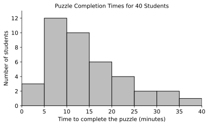
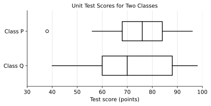
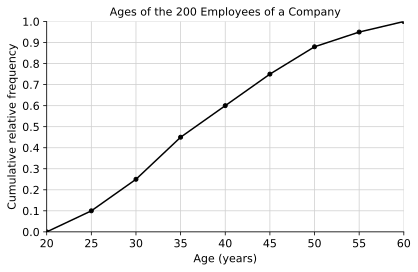
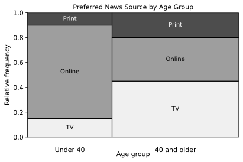
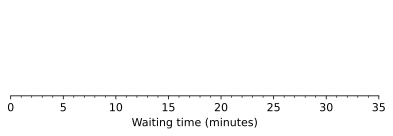

# AP Statistics — Midterm 1 Practice Exam

**Topics:** 1.1–1.13 (Exploring One-Variable Data and Collecting Data) · 2.1–2.2 (Two-Way Tables)
**Total time:** 80 minutes · **Total:** 100 points

| Section | Questions | Points | Suggested time |
|---|---|---|---|
| I · Multiple choice | 13 | 39 (3 each) | 25 minutes |
| II · Free response | 3 | 61 | 55 minutes |

A graphing calculator is allowed. There is no penalty for a wrong answer in Section I.

Name: ______________________________ Date: ______________

---

# Section I: Multiple Choice

**Directions:** Each question is followed by four answer choices. Select the one that is best in each case.

---

**1.** A school nurse records the following information for each student who visits the clinic:

- the time the student spends in the clinic, in minutes
- the reason for the visit
- the number of previous visits the student has made this year
- the postal code of the student's home address
- the student's body temperature, in degrees Celsius

How many of these variables are quantitative?

(A) 1
(B) 2
(C) 3
(D) 4

---

**2.** A survey asked a random sample of 200 students, "Which of the following streaming services do you use? Select all that apply." The results are shown in the table.

| Streaming service | Number of students |
|---|---|
| Service A | 120 |
| Service B | 90 |
| Service C | 64 |
| Service D | 30 |

Which of the following statements about displaying these data is correct?

(A) A pie chart is appropriate, because each streaming service is a category of a categorical variable.
(B) A bar chart showing the percent of students who use each service is appropriate, but a pie chart is not, because the percents add to more than 100%.
(C) Neither a bar chart nor a pie chart is appropriate, because the numbers of students are quantitative.
(D) A pie chart is appropriate, with the slice for Service A taking up 120/304, or about 39%, of the circle.

---

**3.** The stemplot shows the waiting times, in minutes, of 19 commuters at a bus stop.

```
Waiting time (minutes)

0 | 5 7 8 9
1 | 0 1 2 2 4 5 6 8
2 | 1 3 5 7
3 | 0 4
4 |
5 | 8

Key: 2 | 3 = 23 minutes
```

Which of the following best describes the distribution of waiting times?

(A) Skewed to the left, with a median of 15 minutes
(B) Approximately symmetric, with a median of 18.7 minutes
(C) Skewed to the right, with a median of 31.5 minutes
(D) Skewed to the right, with a median of 15 minutes

---

**4.** The histogram shows the times, in minutes, that 40 students took to complete a logic puzzle. Each bar includes its left endpoint but not its right endpoint.



Which of the following is the most likely pair of values for the median and the mean of the 40 completion times?

(A) Median = 12 minutes; mean = 14.4 minutes
(B) Median = 14.4 minutes; mean = 12 minutes
(C) Median = 17.5 minutes; mean = 14.4 minutes
(D) Median = 12 minutes; mean = 12 minutes

---

**5.** The noon temperatures in a city for the 30 days of April had a mean of 15°C, a standard deviation of 4°C, and an interquartile range (IQR) of 6°C. The temperatures are converted to degrees Fahrenheit using F = 1.8C + 32.

What are the mean, standard deviation, and IQR of the temperatures in degrees Fahrenheit?

| | Mean | Standard deviation | IQR |
|---|---|---|---|
| (A) | 59°F | 39.2°F | 42.8°F |
| (B) | 27°F | 7.2°F | 10.8°F |
| (C) | 59°F | 7.2°F | 10.8°F |
| (D) | 59°F | 7.2°F | 42.8°F |

---

**6.** The boxplots summarize the scores on the same unit test for two classes, Class P and Class Q.



Which of the following statements is supported by the boxplots?

(A) More students in Class Q than in Class P scored above 84 points.
(B) The range of the scores in Class P is 40 points.
(C) About half of the students in Class Q scored between 60 and 98 points.
(D) The IQR of the scores in Class Q is greater than the IQR in Class P, and the median score in Class P is greater than the median score in Class Q.

---

**7.** Amira took a chemistry test and a history test. The scores of all the students who took each test are summarized in the table.

| Test | Amira's score | Mean | Standard deviation |
|---|---|---|---|
| Chemistry | 82 | 74 | 5 |
| History | 88 | 80 | 8 |

On which test did Amira perform better relative to the other students who took it?

(A) Chemistry, because her chemistry score is 1.6 standard deviations above the mean, while her history score is only 1.0 standard deviation above the mean.
(B) History, because her history score is higher than her chemistry score.
(C) Neither, because each of her scores is 8 points above the mean.
(D) History, because the standard deviation of the history scores is larger.

---

**8.** The cumulative relative frequency graph shows the distribution of the ages of the 200 employees of a company.



Which of the following is closest to the interquartile range (IQR) of the employees' ages?

(A) 0.50 year
(B) 10 years
(C) 15 years
(D) 30 years

---

**9.** A large high school wants to estimate the mean number of hours per week its students spend on homework. The school has 60 homeroom classes, and each homeroom contains students from all grade levels. The administration randomly selects 4 of the 60 homerooms and surveys every student in those 4 homerooms.

Which of the following identifies the sampling method and gives a reason the school might choose it?

(A) Stratified random sample; it guarantees that every homeroom is represented in the sample.
(B) Cluster random sample; it is more convenient to survey every student in a few homerooms than to find individual students across the whole school.
(C) Cluster random sample; it guarantees that each grade level is represented in proportion to its size in the school.
(D) Simple random sample; every student in the school has the same chance of being selected.

---

**10.** A fitness magazine posted the question "Do you exercise for at least 30 minutes every day?" on its website and invited readers to vote. Of the 4,500 people who voted, 78% answered yes.

Which of the following best describes a problem with using 78% as an estimate of the percent of all adults who exercise for at least 30 minutes every day?

(A) There is no bias, because 4,500 is a large sample.
(B) Voluntary response bias, but the large number of votes cancels out the bias, so 78% is probably an accurate estimate.
(C) Nonresponse bias: many readers did not vote, so 78% probably underestimates the true percent.
(D) Voluntary response bias: people who choose to respond to a fitness magazine's poll are likely to exercise more than adults in general, so 78% probably overestimates the true percent.

---

**11.** Researchers want to know whether a new reading app improves the reading speed of third-grade students. Eighty third-graders volunteered: 40 from School M and 40 from School N. Within each school, the researchers randomly assigned 20 of the volunteers to use the app for 8 weeks and the other 20 to continue with their usual reading lessons. Reading speed was measured for every student at the end of the 8 weeks.

Which of the following best describes the design and the conclusions the researchers can draw?

(A) A completely randomized design; the results can be generalized to all third-grade students.
(B) A randomized block design, with school as the blocking variable; a cause-and-effect conclusion can be drawn for students like those in the study, but the results cannot be generalized to all third-graders, because the students were volunteers.
(C) A randomized block design, with school as the blocking variable; no cause-and-effect conclusion can be drawn, because the students were volunteers.
(D) An observational study, because the students chose to take part; no cause-and-effect conclusion can be drawn.

---

**Questions 12 and 13 refer to the following information.**

A random sample of 400 adults in a town was asked their age group and their preferred source of news. The results are shown in the two-way table.

| Age group | TV | Online | Print | Total |
|---|---|---|---|---|
| Under 40 | 24 | 120 | 16 | 160 |
| 40 and older | 108 | 84 | 48 | 240 |
| **Total** | **132** | **204** | **64** | **400** |

**12.** Of the adults in the sample who prefer online news, what proportion are under 40?

(A) 0.300
(B) 0.510
(C) 0.588
(D) 0.750

**13.** The data are displayed in the mosaic plot.



Which of the following statements is supported by the mosaic plot?

(A) There is an association between age group and preferred news source for the adults in the sample, because the distribution of preferred news source differs between the two age groups.
(B) A greater proportion of adults aged 40 and older prefer online news, because their bar is wider.
(C) The width of each bar shows the proportion of the adults in the sample who prefer each news source.
(D) There is no association between age group and preferred news source, because the segments in each bar add to 1.

**END OF SECTION I**

---
---

# Section II: Free Response

**Directions:** Show all your work. Indicate clearly the methods you use, because you will be scored on the correctness of your methods as well as on the accuracy and completeness of your results and explanations. Label each part (A, B, C …) and sub-part (i, ii) of your answer.

---

## Question 1 (20 points) · Sugar in breakfast cereals

A nutrition researcher recorded the amount of sugar, in grams per serving, in a random sample of 20 breakfast cereals marketed to children and a random sample of 20 breakfast cereals marketed to adults. The data are listed in order.

| Cereals | Sugar (grams per serving) |
|---|---|
| Children's | 6, 9, 10, 11, 11, 12, 12, 12, 13, 13, 13, 14, 14, 14, 15, 15, 16, 16, 17, 18 |
| Adults' | 0, 1, 2, 3, 4, 4, 5, 5, 6, 6, 6, 7, 8, 9, 10, 11, 12, 14, 16, 20 |

**Part A** (5 points)
Construct a back-to-back stemplot that displays both distributions. Include a key.

**Part B** (4 points)
Describe the distribution of sugar content for the children's cereals.

**Part C** (5 points)
Compare the distributions of sugar content for the children's cereals and the adults' cereals.

**Part D** (6 points)
The researcher also recorded the shelf on which each of the 20 children's cereals was displayed in a supermarket.

| Shelf position | Bottom | Middle | Top |
|---|---|---|---|
| Number of cereals | 9 | 8 | 3 |

i. Construct a relative frequency bar chart of the shelf positions of the children's cereals.
ii. Would a pie chart also be an appropriate display of these data? Explain.

---

## Question 2 (20 points) · Waiting at the bank

A bank manager selected a random sample of 15 customers and recorded the time, in minutes, that each one waited in line before being served. The times, in order, are:

> 2, 3, 3, 4, 5, 5, 6, 7, 8, 8, 9, 10, 12, 14, 31

**Part A** (4 points)
Determine the five-number summary of the waiting times.

**Part B** (2 points)
Interpret the third quartile in the context of this study.

**Part C** (5 points)
Use the 1.5 × IQR rule to determine whether there are any outliers in the data. Show your work.

**Part D** (4 points)
Construct a boxplot of the waiting times on the axis below. Show any outliers as separate points.



**Part E** (3 points)
The mean waiting time for these 15 customers is 8.47 minutes. The manager wants to report one number that describes a typical customer's wait. Should the manager report the mean or the median? Justify your answer using the data.

**Part F** (2 points)
The manager discovers that the time of 31 minutes was recorded incorrectly; the correct time is 13 minutes. When 31 is replaced by 13, which of the following statistics will change: the mean, the median, the standard deviation, the IQR? Explain.

---

## Question 3 (21 points) · Water use in Riverton

The city of Riverton has about 40,000 households in 8 neighborhoods. The neighborhoods differ a great deal in household income and in the size of their homes and gardens. The water department plans two studies.

**Study 1 (a survey).** The department wants to estimate the proportion of all households in Riverton that would support a new rule limiting garden watering to two days a week.

**Part A** (3 points)
Determine a valid investigative question for Study 1. Make sure your question includes all three components of a valid investigative question.

**Part B** (5 points)
i. Describe how the department could select a stratified random sample of 400 households, using the neighborhoods as strata.
ii. Explain why stratifying by neighborhood is a good choice for this survey.

**Part C** (4 points)
A department employee suggests posting the survey on the department's social media page instead, and using every response received. Identify the type of bias this method could cause, and explain how it would likely affect the estimated proportion of households that support the watering rule.

**Study 2 (an experiment).** The department wants to know whether sending households a weekly text message that compares their water use with their neighbors' water use reduces the amount of water they use. Two hundred households volunteered for the study: 80 of them have gardens and 120 do not. The amount of water each household uses in the 8 weeks of the study will be measured from its water meter.

**Part D** (6 points)
i. Identify the treatments, the experimental units, and the response variable.
ii. Having a garden is likely to affect a household's water use. Describe a randomized block design for this experiment that uses garden as the blocking variable.

**Part E** (3 points)
Suppose that the households that received the text messages used significantly less water, on average, than the households that did not. Explain whether the department can (i) conclude that the text messages caused the reduction in water use, and (ii) generalize the result to all households in Riverton.

**END OF EXAM**
